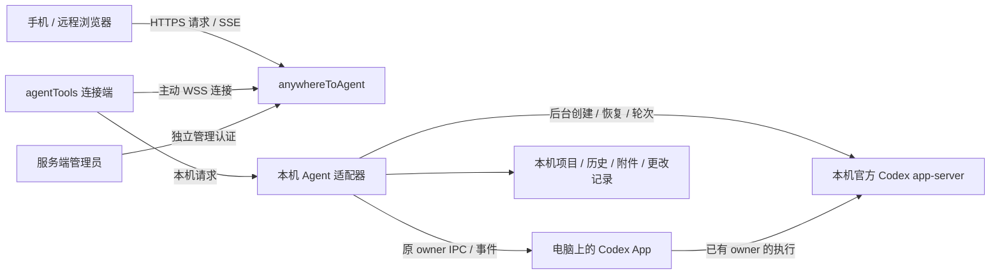

# 架构与授权边界

anywhereToAgent 是独立 Go 模块 `anywheretoagent`，提供公网中转、远程网页和服务端管理页。agentTools 内置连接端、Agent 注册表与执行适配器，可按本机配置启用 Codex 与 Claude Desktop。两者通过 WebSocket 协议通信，分别构建和部署；服务器不导入 agentTools 的网关、账号或本机进程代码。

## 阅读范围与验证记录

本文描述两端当前的职责和协议；客户端实现位于 agentTools，修改跨端契约需同时核对两端代码。文中带日期、版本号或测试数量的段落是对应改动的历史记录，不代表当前 checkout、生产环境或所有平台已重新验收。

部署操作见 [deploy.md](deploy.md)，前端结构见 [web/README.md](../web/README.md)。专项历史结果见 [共享 App 提问兼容记录](shared-questions-qa.md) 和 [设计 QA](../design-qa.md)；发布时应另记录实际提交、检查范围、失败项和未验证项，不能累计引用历史通过数作为本次验收结果。

## 职责

| 部件 | 负责 | 数据所在位置 |
| --- | --- | --- |
| agentTools“远程连接”页 | 选择预设/自部署服务、Codex 原生项目目录与可选额外目录、连接状态、生成二维码/授权码、已授权浏览器与撤销 | 用户电脑 |
| agentTools 连接端 | 主动 WSS 连接、配对、签发和校验浏览器授权、转发到本机执行引擎 | 用户电脑 |
| 本机 Agent 适配器 | 读取原生历史、新建/继续/停止任务、工具审批、文件和更改、SSE 事件 | 用户电脑 |
| Remote | 设备路由、浏览器入口、请求/响应和事件中转、设备凭证哈希、私有浏览器会话映射 | 公网服务器 |
| Remote 管理页 | 服务监听、公网地址、新设备注册设置、服务状态 | 公网服务器 |

中转只转发应用层端到端加密数据，继续保留 HTTPS/WSS。电脑与浏览器使用 AES-256-GCM 和 HKDF-SHA256；256 位配对秘密只在完整授权码/URL fragment，独立会话密钥与原始授权 token 经加密配对交付。Remote 不持有解密密钥，状态文件只存设备/浏览器授权 ID 的路由映射。

POST /api/pair 接收 {device_id,id,data}，向电脑 /_remote/pair 转交 {id,data}，验证返回 sealed 的形状和元数据后建立 HttpOnly cookie。POST /api/secure 将 {id,data} 原样流式转到电脑 /_remote/secure，外层只带公开授权 ID；方法、路径、headers、正文与原始授权 token 在密文内。响应 application/x-ndjson 由认证 head/data/end 记录组成，序号、方向、请求 ID 绑定认证附加数据；浏览器验证完整结束，不信任中转明文错误中的会话字段。会话、队列、SSE、文件预览/下载及全部附件都走同一加密入口，保留取消、撤销、背压和有界窗口；浏览器不使用明文 EventSource 或原始资源 URL。

旧明文配对和会话/文件 API 拒绝。两端须一起升级，旧浏览器需重新配对，不能降级。启动加载完整合法状态后原子删除旧原始 grant 映射，保留设备和新加密授权；读取错误仍拒绝启动。电脑持久化短期请求 ID 防重放。外层请求上限 48 MiB（加密与 Base64 开销），实际附件仍由本机限制 20 MiB。

电脑须登录 active FullCupAI 账户且余额严格大于零，GUI/无界面入口、配对、每次执行与最长 30 秒周期复验均在电脑实时向平台确认，读取错误拒绝使用。退出/切换账号断开连接；浏览器授权绑定签发账户。默认官方中转的设备握手通过原生专用头 `X-Remote-FullCup-Token` 临时提交访问凭证，中转只向固定 `https://tobapi.fullcupai.com/api/v1/auth/me` 核实用户 ID 和资料，拒绝重定向及失效/停用账户；不保存或记录平台 token。本机不向自部署中转自动发送可复用的平台 token，自部署用户在账户页面明确登录后绑定当前已配对设备。既有设备始终验证原设备凭证；未携平台身份的重连保留原归属，携重新验证的其他账户身份及正确设备凭证时撤销旧浏览器路由授权后转移归属。

`/account` 是用户设备页，使用同一 FullCupAI 邮箱/密码及平台要求的 TOTP 登录；平台访问 token 也可作为原生交接输入，不返回浏览器。密码、平台访问及刷新 token 均不持久化；服务端只保存 FullCupAI 用户资料及 12 小时 HttpOnly、SameSite=Strict 账户会话的随机值哈希。账户登录仅授予查看、重命名、撤销该账户设备的目录权限，不签发 E2EE 密钥，不替代各电脑的浏览器配对授权。持有某个电脑配对码也不能进入该账户设备管理。

`GET /api/account` 返回当前用户与其设备；`POST /api/account/device` 以 `{id,name}` 重命名或 `{id,revoke:true}` 撤销，跨账户 ID 返回 404。管理员仍使用独立的管理凭证与认证，`/api/admin/state` 增加用户和设备所属用户 ID，`POST /api/admin/user` 的 `{id,disabled}` 可以停用或恢复中转用户。停用会原子撤销其账户会话和浏览器路由授权，并断开其在线设备；恢复后须重新登录/配对，不能复活旧会话。用户资料默认来自平台，无本地注册密码或邮箱修改接口。平台验证码挑战或第三方登录暂不代理，失败会明确提示；TOTP 使用平台真实 `totp_code` 字段。

自部署设备可在账户页通过 `POST /api/account/claim {}` 绑定。它同时要求账户会话和所选设备的已配对 HttpOnly 会话，不接受任意设备 ID；已归属其他账户时返回 409。`GET /api/account` 的 `current_device` 及绑定操作均按 `X-Remote-Device` 选择同一设备 cookie，不能误用上一次配对的通用 cookie。设备切换只选择本浏览器保留的独立加密凭据；每个标签页固定自己的当前设备，其他标签页切换不改变本页后续命令的路由。

安全边界：Remote 仍知路由标识、设备名、在线状态、时间和密文大小。网页脚本由中转提供，密钥在同来源 localStorage；端点失陷、同来源 XSS 或恶意替换脚本可窃取密钥。因此本方案防被动中转读取和状态文件泄漏，不承诺抵抗恶意网页服务器或前向保密。可信 HTTPS 来源与静态资源完整性仍为前提。

## Agent 接口与目录边界

中转的设备登记、授权、密文转发和 HTTP 隧道不依赖某个 Agent。Agent ID、会话路径、owner epoch 和能力均在端到端密文内，中转不解析、不保存，不把它们加入公开 WebSocket 注册元数据。新增适配器不要求在服务端添加执行分支。

本机 `internal/remoteclient/agent` 定义 `Descriptor`、`Config`、`Runtime` 与 `Adapter`；`engine.Registry` 按稳定 ID 选择适配器。同一设备连接可启用 Codex 与 Claude Desktop 两个独立本机 Agent，由客户端配置声明默认 Agent。各自连接、失败、重试和断开互不影响；未知适配器拒绝配置。加密 `GET /api/agents` 返回 `{agents:[{id,name,state?,problem?}],default_agent}`，列出本连接全部已选适配器；`state` 为 `connecting`、`connected`、`disconnected` 或 `unavailable`，无 state 的旧客户端继续兼容。新增适配器须提供客户端实现及网页能力适配，单独注册名称不会产生执行能力。

加密请求可带 `X-Remote-Agent`；不带时兼容客户端默认 Agent，带已选 ID 时路由到对应引擎，未连接的已选 Agent 返回 `503`，未知 ID 返回 `409`，防止旧会话操作被投递到另一种执行引擎。`X-Remote-Owner-Epoch` 是通用 owner 代际字段，Codex 保留旧 `X-Codex-Owner-Epoch` 兼容。网页所见能力仍来自真实适配器，不能仅靠 Agent 名称宣称支持队列、计划或审批。网页侧栏提供明确的 Agent 选择及各自状态；故障条目可查看原因但禁止操作，状态刷新不重置健康 Agent。连接、重试和启动仅在本机 agentTools 执行，网页不调用这些生命周期接口。选项、草稿、项目及创建 UUID 按设备和 Agent 隔离。切换会取消旧请求并推进 generation，迟到列表、详情和事件不得覆盖新选择。Agent 发现、会话列表和其它上游接口失败会显示原错误；上游 503 只触发设备状态核对，不把已确认在线的电脑直接改成离线，也不重放写操作。只有设备接口的明确状态决定电脑离线；探测失败显示未知。

服务端目录按运行职责划分：

| 路径 | 职责 |
| --- | --- |
| `cmd/anywhereToAgent` | 进程入口、配置参数、监听与退出；兼容旧默认数据路径 |
| `internal/relay/server.go`、`http.go`、`assets.go` | 服务生命周期、来源校验、可信代理 IP 与限流、路由及嵌入网页 |
| `internal/relay/devices.go`、`connection.go`、`state.go` | 设备目录/撤销、WSS 登记与心跳、原子私有持久化 |
| `internal/relay/sessions.go`、`pairing.go`、`secure.go` | 浏览器授权映射、配对、受限密文代理 |
| `internal/relay/admin*.go` | 独立管理凭证/会话、来源校验、管理路由 |
| `internal/transport/tunnel` | 有界 HTTP 帧、共享 WebSocket peer、请求/响应及背压，不导入 Agent 执行代码 |
| `web/src/agents` | 网页 Agent 适配入口；现有 Codex 控制及展示逻辑保留其专属语义 |

名称兼容：二进制和新部署模板使用 `anywhereToAgent`，Go module 使用 `anywheretoagent`。既有 `relay-state.json` schema、`admin-token`、`codex-remote` / `__Host-codex-remote` 浏览器 cookie 以及 `codex-relay-admin` 管理 cookie 保持不变，重命名不会清除浏览器授权。通用写请求标记为 `X-Remote-Request: 1`、管理标记为 `X-Remote-Admin: 1`，同时接受原 `X-Codex-Remote` / `X-Codex-Admin`，来源校验不变。中转向旧客户端转发时仍附带旧请求标记；浏览器提供的明文 Agent、owner、游标与任意其它头全部剥离。新安装默认使用系统配置目录下 `anywhereToAgent`；原 `codex-remote` 路径已存在时继续使用原位置；显式数据目录优先，服务不会迁移、合并或删除目录。Compose 的新入口变量为 `ANYWHERE_TO_AGENT_PUBLIC_URL`，原 `CODEX_REMOTE_PUBLIC_URL` 继续作为后备值。

### 原生 owner 的细分能力

网页允许 owner 独立声明 `queue_add`、`queue_cancel`、`queue_reorder`、`queue_edit`、`queue_resume`。缺少某个细分字段时兼容旧 `queue`；明确 `false` 不回退。目录可通过 `queue_read` 开放读取，但不因此授权任何写操作。未知队列保留最近观测记录并显示暂停，不能按空队列处理。重排提交原消息 ID 和 `{over: adjacentUUID}`，不删除重建消息。

`live.pending_plan_approval: true` 和匹配的 `live.pending_plan.id` 表示执行器正在等待原生计划审批，即使当前轮次仍处于运行状态。执行继续使用 `execute-plan`，修订发送 `revise-plan {plan_id,feedback}`；它回应原请求，不另发普通任务。两个入口仍需要当前 owner 的 `plan` 能力和 epoch。普通已完成计划保持原流程。

空会话目录可声明 `creation_request_id`，网页在 POST 前按设备、Agent、项目保存稳定 UUID 与创建参数；未知结果仅由用户明确重试同 UUID。已分配 ID 的错误回执恢复原会话，不另建或自动发送首条消息。回执使用有界同标签页 sessionStorage，不包含消息或凭据；存储不可用、数据损坏或未知请求参数改变时拒绝创建。`creation_default_permissions_only` 会明确拒绝非默认模式或权限预选并保留草稿，不静默忽略设置。

所有能力、UUID、计划与 owner 数据均位于原有加密请求中。中继服务器仍不执行 Agent、不解析或批准这些操作；网页能力声明也不能替代本机范围、组织策略或权限校验。

## 一次配对与长期授权

1. 客户端选择中转 URL，生成并持久化设备身份和设备连接凭证，主动连接服务器。服务器保存设备凭证的哈希，用于后续重连，设备 ID 只用于路由。
2. 用户在 agentTools 点击生成授权码。客户端生成一次性随机码，有效 10 分钟，并在本机生成包含完整授权信息的二维码。二维码不提交第三方生成服务。
3. 浏览器打开中转网页，扫码或输入完整 `设备 ID.授权码`。服务器将配对请求转发到对应客户端；仅知道设备 ID 不允许访问。
4. 客户端解密并消耗配对秘密，签发有效期 30 天的浏览器授权，原始 token 仅加密返回浏览器。服务器将公开授权 ID 映射到 HttpOnly 会话，不保存原始 token 或会话密钥，不把秘密放入查询参数或日志。
5. 每次会话/文件请求在密文内携带客户端授权，由电脑解密并校验有效期、账户、撤销和重放状态。服务器重启后可恢复映射，但不能绕过离线、过期或已撤销的客户端授权。
6. 客户端可列出并撤销某个浏览器。撤销后其后续请求失败，活动流也终止；如需再次连接，用户重新生成授权码并配对。

授权码单次使用，重新生成会使先前未使用的码失效。客户端明确断开连接不等于撤销所有长期浏览器授权；再次连接后，仍有效且未撤销的授权可以恢复使用。删除客户端身份或清除授权状态会使旧授权失效。不要在客户端不在线时仅由服务器批准新浏览器。

配对应答的 `expires_at` 保留电脑签发的原值，与 `sealed` 内经过认证的到期时间一致；中转会话和 HttpOnly cookie 独立采用该期限与服务器当前时间加 30 天两者的较早值。电脑时钟略快时不会因中转截短期限而误报加密验证失败，网页仍拒绝元数据不一致、过期或篡改的配对应答。

同一浏览器可记住最多 16 台电脑的独立 E2EE 授权。每次成功配对同时设置原有通用 HttpOnly cookie 和带公开设备 ID 后缀的独立 HttpOnly cookie；第二台配对保留第一台授权，重新配对只替换同一台电脑的旧授权并取消其旧流。浏览器以 `X-Remote-Device` 选择设备，服务端只接受单个 32 位小写十六进制 ID，并要求对应 cookie 映射的设备完全匹配；设备 ID 或账户登录自身不授予访问。未携带选择头时沿用原通用 cookie，旧浏览器仅有通用 cookie 时也只能选择该 cookie 已授权的设备；首次配对另一台时原授权补存为独立 cookie。退出只撤销选中设备授权和其活动请求，保留其它设备；独立 cookie 与对应的通用 cookie 一起清除。E2EE 密钥继续只在浏览器和本机，设备选择头不转发给本机。

设备登记开关只控制新设备注册。关闭后，已登记客户端仍可用原凭证重连；浏览器仍需得到客户端授权。服务端管理凭证与客户端配对授权不能互换。

## 连接与任务生命周期

客户端主动连接 Remote，家庭网络和 NAT 无需开放入站端口，也无需逐用户 SSH 反向隧道。默认服务只是一个预设 URL，自部署服务使用同一协议。公网使用 HTTPS/WSS；HTTP 仅供本机回环开发。

短暂断网或中转重启会中断传输，客户端按退避策略重连；本机执行引擎保持运行。浏览器恢复后读取当前快照再接收增量，刷新页面不会重发任务。显式断开远程连接或退出 agentTools 则关闭其共享执行连接；原 App 持有的会话和共享 app-server 中的任务继续运行。其它 Codex App 进程不由连接端管理。

事件流以本机 SSE `id` 和加密 `Last-Event-ID` 支持续接；游标、正文和恢复状态都在端点，中转不解析或保存。电脑缓存最多 64 个状态、估算 8 MiB、每项最多 4 MiB，有效 2 分钟；匹配会话/owner 时补齐显示状态变更，否则返回 reset 快照。不是逐 token 日志回放。浏览器只为事件流按 0.5–10 秒退避重连，关闭取消；认证/4xx、加密认证或完整性错误终止，归档/不可用事件终止。不自动重试任何控制或附件写入。旧网页忽略新增 id，旧电脑不发 id 时继续以快照恢复。

本机 app-server 断开后，只读 RPC 可在 10 秒内重建同模式执行连接并重试一次；共享 daemon 不降级为独立进程。连接恢复不重发消息/审批，不自动恢复轮次，旧 epoch 的控制仍拒绝。重新连接会话需由电脑确认真实 owner；中转不参与执行所有权恢复。版本/传输/IPC 支持范围只在 agentTools 本机诊断导出，不向公网暴露诊断端点。

中转在设备登记成功后每 20 秒发送 WebSocket Ping，8 秒内没有 Pong 就关闭该传输并释放设备在线占用，防止代理残留的旧连接一直拒绝同一设备重连。关闭连接不撤销设备或浏览器授权，也不终止本机任务；仍在线的连接不能被新连接顶替，重连仍校验原设备凭证与撤销状态。正常断开、管理员撤销和服务关闭都会取消并等待心跳退出。实现位于 [`connection.go`](../internal/relay/connection.go)，失联回收、正常设备保持在线及原凭证重连的回归位于 [`devices_test.go`](../internal/relay/devices_test.go)。这是标准 Ping/Pong 控制帧，不改变两端注册与业务消息协议。

执行中的补充消息默认排队；网页可编辑等待或失败项、引导当前轮次或删除。编辑使用 `PATCH /api/threads/{id}/queue/{messageID}`，保持消息 ID、顺序和原附件；不允许修改投递中或结果不确定的消息。原 App owner 使用其原生队列：本机只读初始 `queued-follow-ups` 状态，随后接收经过 owner 验证的 `thread-queued-followups-changed` v2，修改通过 `thread-follower-set-queued-follow-ups-state` v1 执行。队列不在会话快照里；读取失败不能视为空，不能覆盖 App 已有消息。原生消息通过队列项 `native: true` 标识；即使 owner 已转为后台，其文本编辑仍只传 `{text}`，执行端保留完整原始上下文、附件和提交选项。

自有后台会话使用本机持久队列，并通过同一原生队列广播及控制供 App 跟随；服务器只中转 API 和 SSE。一个会话只有实际 owner 负责投递，跟随 App 时本机 worker 不再另行发送。旧本机队列保留可见、暂停，明确恢复后按原 ID 迁移并保留 App 已有内容；不确定结果不能自动迁移或重发。后台队列正常完成后按顺序发送下一条，失败、中断或本机引擎重启后暂停。入队使用有界幂等收据，最多每会话 32 条、全局 256 条；本机队列每会话最多 16 条、全局最多 100 条。

引导绑定当前轮次和稳定消息 ID。网页调用 `POST /api/threads/{id}/queue/{messageID}/steer` 时携带点击时所见的 `expected_turn_id`；缺失、空或已过期的轮次均拒绝，不自动改向新轮次。当前 App 的开始轮次返回 `{result:{turn:{id}}}`，引导返回 `{result:{turnId}}`；连接端按真实结构确认。临时引导气泡可能早于执行确认，不能据此判断成功或自动重试。远程页面显示实际 `steeringUserMessage.input`，保留源消息的 pending/accepted 状态；不把“已接受”当作任务完成。owner 切换时重置队列版本并丢弃旧请求响应。

SSE 增量经 WebSocket 转到 Remote，再持续发送给浏览器；代理必须支持 WebSocket Upgrade 并关闭 SSE 缓冲。中转断开不能伪造成任务完成。取消请求、慢浏览器、消息尺寸和并发均需要有界处理，不能无限缓存完整输出。

2026-10-20 续传验收：本地全 Go 模块 race、网页 typecheck/资源构建和 Chromium/WebKit 全网页 226 项通过；加密传输与续传聚焦 8 项覆盖 cursor、关闭取消、503/断网重试、401 终止和密文完整性终止。使用最终资源的真实本地 Relay 与 agentTools Manager 双浏览器加密互通通过，执行引擎使用 fake。未部署公网或使用真实 App/模型、手机及 Windows/Linux 实机验收。

## 本机执行与权限

`internal/remoteclient` 位于 agentTools：连接管理、设备身份、配对和浏览器授权；其 `agent` 子包定义执行适配接口，`engine` 子包注册和选择适配器；当前 Codex 实现负责原有会话能力。模型供应商、API 接入和 Codex 数据目录都来自用户电脑的配置。需要经过 agentTools 网关时，沿用 agentTools 的 Codex 接入；Remote 不改变模型请求路径。

Codex 原生项目目录与明确配置的额外目录限定历史列表和文件搜索。文件引用、预览和下载还允许当前用户临时目录及 Codex home 下的 `worktrees` 子目录，以显示运行中生成的文件；浏览器不能指定这些目录以外的范围。目录由本机只读 App 状态、官方 SQLite 索引和上述固定本机路径确定，无需逐个共享。网页主菜单使用 Codex 的三档审批模式：请求批准（内部值 `workspace-write`）映射为 workspace-write 沙箱、`approvalPolicy: on-request` 和 `approvalsReviewer: user`；帮我批准（`auto-review`）使用同一沙箱与审批策略，并设置 `approvalsReviewer: auto_review`；完全访问（`full-access`）使用 danger-full-access 沙箱、`approvalPolicy: never` 和 reviewer user。旧 `read-only` 会话保留兼容。full-access 按本机运行用户权限执行，不能把共享文件列表误认为操作系统沙箱。

原应用会话以实际 owner 的设置为准。网页更改模型、强度、模式或权限时调用 `POST /api/threads/{id}/settings`，携当前 owner epoch，仅传用户改变的字段；等待本机原 owner 的规范快照确认后返回 `options`，详情及 SSE 的 `live.options` 同步实际设置。请求未确认时保留原设置与草稿，不伪装为保存成功。普通发送未明确选择新设置时继承原 owner，不重新应用网页默认沙箱或 reviewer。自定义沙箱、额外根目录和不能准确映射的命名 profile 保持自定义，不自动转换成只读或完全访问。组织 requirements 和原 App 的验证仍适用，原生拒绝或未确认时报告错误，不降级伪装为已启用。

运行中补充消息进入原生 owner 队列时同样不携带网页模型、强度、模式或权限偏好，避免过时偏好触发原生设置冲突；由原 owner 当前设置决定执行。原生消息ID、防重回执、队列细分能力及 owner epoch 校验保持原有路径。Claude Desktop的排队消息等待当前任务结束，不因此宣称支持严格指定当前轮次的即时引导。

执行引擎保留流式文本、可用的思考摘要、命令/工具、审批、追问及计划。 完全访问映射为原生完整沙箱权限及 `approvalPolicy: never`；其它权限保留原生按需审批。Computer Use 的应用授权独立于沙箱，不能由完全访问自动批准。网页只在工具明确提供记忆范围时显示本会话/始终允许按钮，由用户选择；客户端校验请求提供的范围后传递 `_meta.persist`。通用工具问询与 URL 授权不适用此记忆逻辑。只有完成的原生 plan item 才形成待执行计划；用户明确执行才新开执行轮次，同一计划防止重复执行。网页在计划完成后提供执行与继续修改两个入口；继续修改会打开补充意见弹窗，在同一会话以计划模式发送意见，保留普通输入框的草稿和附件。修订后的计划完成后再次等待用户选择，提交失败则保留意见供重试。命令产生的文件通过轮次前后的真实工作区快照补充更改记录，不从命令字符串猜测文件；扫描和预览仍有边界及截断提示。这些测试与详细实现随 agentTools 连接端维护，服务器不再扫描文件系统。

仅读取原生历史不等于接管执行进程；可控制状态须由本机确认实际 owner 和能力。上游不发送的增量、隐藏推理及私有功能不能由中转恢复。

## 子智能体观测

连接端声明 `options.capabilities.subagents: true` 时，网页读取加密 `GET /api/threads/{id}/agents`。父会话有子智能体或明确的子智能体调用记录时，在输入框上方显示“智能体”气泡；点击列出名称及可确认状态，再点击名称打开只读对话。列表和详情沿用本地组件、工具/思考展示及五语言翻译，支持手机布局和加载更早历史，不改变父会话选择、草稿、附件或 owner。未声明能力的旧连接端不请求该接口。

列表返回 `{agents:[{id,name,role,parent_id,status,cwd,last}]}`；详情使用加密 `GET /api/threads/{id}/agents/{agentID}?cursor=`，返回 `session`、`history` / `history_items`、`history_next_cursor`、`history_has_more`、`read_only: true`，富历史降级时可能附带 `history_error`。执行中或弹窗打开时每 2.5 秒串行轮询，隐藏页面暂缓读取，切换父会话、设备、Agent 或关闭详情时取消/隔离迟到响应。子会话读取失败只影响观测区域，不把子会话的归档错误应用到父会话。

父子关系、项目授权和归档校验完全由 agentTools 执行，普通会话列表也由连接端过滤子智能体；中转不读取明文关系或会话内容。观测请求不连接、恢复、发送、引导或停止子智能体，详细对话不提供父会话的文件操作。状态没有权威证据时显示未知，原生 `closed` 只显示已停止，不推测完成或失败。本次回归使用本地 fake 客户端和加密浏览器夹具，不能代替真实 App 子智能体、公网和手机实机验收。

## 服务端配置和持久化

`cmd/anywhereToAgent` 启动网页/中转监听及独立管理监听。`internal/relay` 维护服务端，`internal/transport/tunnel` 定义传输协议。网页资源嵌入二进制。配置只有 `public_url`、`listen_address`、`data_dir`、`registration_enabled` 和可选的 `trusted_proxies`，不包含 Codex 程序、Codex home、共享根目录、SSH 或模型凭证。`trusted_proxies` 只允许明确列出的反向代理 CIDR 影响限流地址解析。

私有数据目录保存 `relay-state.json` 和 `admin-token`；示例将管理员提供的配置文件也存为该目录的 `config.json`，只有显式指定 `--config` 才加载它，服务不会自动重写配置文件。状态写入先同步临时文件，再原子重命名并同步父目录；成功重命名后，内存状态跟随该文件，即使目录同步报告错误也不会回退到旧状态。Windows 上 Go 没有可移植的目录同步接口。`relay-state.json` 保存设备凭证哈希、浏览器授权映射、FullCupAI 用户资料、设备用户关联/别名及账户会话哈希，权限 0600；会话映射及用户资料仍须私有保护；不含平台凭证、原始授权 token 或加密密钥。原状态无需迁移文件即可载入，新增字段之后旧二进制因严格解析会拒绝读取；回滚应使用同时备份的旧状态，并知悉备份后撤销/新增的授权差异，不能静默删除新字段。`admin-token` 是独立管理凭证，也为 0600。解析失败不能当作空授权列表覆盖原状态，应报告错误并保留原文件。

普通聊天与账户页面不显示中转管理入口，管理员仍通过原 `/admin/` 地址和独立管理凭证进入。设备选择与当前连接状态合并为一个区域；列表按各设备已有浏览器授权读取在线状态，在线绿色、离线红色，无法确认时灰色，不更改当前设备选择或凭据。

管理监听默认 `127.0.0.1:9090`，服务器网页监听默认 `127.0.0.1:8080`。反向代理须保留原始 Host；写请求校验 Origin 和专用请求头。服务端管理权限仅管理中转实例，不授予任何客户端的 shell 或项目访问。

## 维护与验证

左右面板共用指针捕获和键盘调宽逻辑；右侧文件/更改面板从左边缘向左拖动增宽，宽度按浏览器单独记忆。Home/End 与方向键可调宽，Escape 取消当次拖动；桌面两侧上限保留会话正文空间，窄屏抽屉受视口限制，手机隐藏调宽手柄。

远程聊天页使用 React 19 与 Solid Glass。`web/src/remote.jsx` 启动应用；`RemoteApp.jsx` 组合 `views/Pairing.jsx`、`Workspace.jsx` 和 `Dialogs.jsx`。`controller.jsx` 保留共享控制器状态和 feature 装配；`features/` 按会话、owner、生命周期、设备、消息、事件流、队列、设置、审批、附件、建议、文件及计划拆分，`features/bindings.jsx` 管理 DOM 事件，`render.jsx` 同步提交 React 动态区域。加密 HTTP、取消与 owner 代际请求位于 `transport/api.js`，加密与续传实现位于 `transport/secure.js`；经 `RemoteSecure.fetch/events` 的 API、文件、附件和 SSE 请求都在密文内固定当前 `X-Remote-Agent`，owner 控制同时发送 `X-Remote-Owner-Epoch` 和兼容用的 `X-Codex-Owner-Epoch`。Agent descriptor 从加密 `GET /api/agents` 读取；每会话选项的 `agent` 须与当前 active Agent 一致。`agents/registry.js` 选择适配器，`agents/codex.js` 集中 Codex 的模型与 reasoning effort、权限、审批类型、来源标签、历史内容和桌面 deeplink 语义；未知 descriptor 使用不含 Codex deeplink 和权限推测的通用展示适配器。Agent 切换会取消旧请求和事件流、清除会话/owner/队列状态，并按 Agent 隔离草稿，避免相同会话 ID 被投到新执行端。Agent 执行仍由本机连接端负责，中转不解释或持有密文内的 Agent 字段。管理后台 `admin.jsx` 使用独立 React 状态与管理认证。Solid Glass 上游源码和 MIT 声明随项目保存，所有 JS/CSS 由 Vite 本地打包进 Go 资源，无 CDN、外部字体请求或额外运行服务。公共固定路径 JS/CSS 在进程内预压缩，支持 gzip、基于内容的弱 ETag 及每次使用前重验证，未变化返回 304；HTML、账户/配对 API、密文请求和会话数据仍为 `no-store`，不进入此静态缓存。深浅外观可切换，偏好仅存在本地浏览器。手机宽度（不超过 760px）或粗指针设备上的文本输入控件至少 16px，避免 iOS 聚焦自动放大；viewport 继续允许用户缩放，不设置 `maximum-scale` 或 `user-scalable=no`。移动布局与焦点回归在 Chromium/WebKit 及支持语言中验证，仍需 iPhone 实机键盘验收。

模型和思考强度共用设置卡片；模型选择仍使用原有菜单。滑块只使用当前模型返回的 `supportedReasoningEfforts`，拖动 `input` 仅预览，`change` 才沿既有 settings 路径提交一次。等待实际 owner 的规范设置确认，失败恢复已确认值并保留草稿；owner/generation 变化关闭卡片，不把旧控件的选择发送给新会话。恢复默认沿用模型或配置的真实默认档位；空或单档列表禁用滑块，不添加并不存在的 Ultra 档。

工具调用在同一已知 `turn_id` 内按连续项展示为可展开批次，消息、思考、计划及其它活动会结束当前批次。当前协议没有原生批次 ID，因此此分组只影响网页展示，不改变执行顺序或推断并行关系；缺少轮次 ID 的调用保持独立。批次保留每条调用的原有详情，流式更新保留批次及内部调用的展开状态。

一次同步绘制内，控制器只收集一次已加载消息、更改、轮次顺序与标签，并按轮次建索引供历史、实时正文、摘要和文件面板复用；绘制结束通过 `finally` 清空，不跨异步请求缓存。`mergeOrdered` 对已有 ID 的纯内容替换使用线性路径，历史前插及锚点插入保持原有顺序规则。消息原有 React key、同步提交与阅读锚点保持不变。

Markdown 正文按实例复用，只有文本或语言、设备、Agent、会话、选择代际上下文变化时重新解析；资源点击仍执行当前授权检查。审批、owner、交互和子智能体等动态卡片不按消息 ID 缓存，只有状态变化而没有正文增量时仍更新。优化不修改 SSE 格式、续传、事件合并窗口或端到端加密。纯计算与正文复用回归位于 `tests/history-performance.test.cjs`、`tests/markdown-memo.test.cjs`，长历史浏览器用例见 [`remote-workspace.test.cjs`](../tests/remote-workspace.test.cjs)。

输入框旁的上下文圆环使用本机返回的当前用量与窗口大小，点击查看具体 token 数；图形限制在 0–100%，文字保留真实数值。未知用量显示未知环，不显示成 0% 或保留上次进度；压缩状态独立显示，压缩后跟随新的实际用量。现有数据不包含输入/输出分类，因此详情不推测这些值，也不把当前请求用量解释为会话累计消耗。

连接诊断与日志导出由 agentTools 本机连接页提供，受本机 Host/运行令牌保护；Remote 不接收这些诊断 API，也不保存设备凭证、配对码或会话正文日志。macOS / Windows GUI 的共享启动及就绪检查均由本机连接端负责，网页不选择桌面启动方式；历史可读不等于执行服务已连接。

改动协议应同时更新两端的发送方/接收方、认证边界、浏览器和夹具。两端均需要本地 fake peer 的行为测试：一次性码、过期/撤销、错误设备凭证、跨来源、重连、慢流和取消。服务端执行 `make test-race`、`make vet` 和浏览器回归；客户端执行 `go test -race ./internal/remoteclient/...` 并运行对应 GUI 测试。Go 测试使用隔离配置及 HOME，不能访问用户真实凭证。

部署模板与代码检查不能替代真实公网配对验证。容器构建、系统服务启停、真实移动设备及目标服务器的检查结果需要在发布记录中分别注明。

## 后台会话执行与同步

网页新建显式发送 `POST /api/threads`、`executor: "background"`，连接端省略 executor 时也默认后台新建；本机 `createBackground` 校验共享项目及设置，通过官方 `thread/start` 创建、`thread/name/set` 持久化，并保留执行连接。所有 Codex 连接入口均复用经过验证的 App 共享服务，不再启动独立 stdio 执行器，也不在 Windows 新建后自动打开深链接。`background` 表示会话控制方式，不是另一种连接模式。旧 `executor: "remote"` 创建请求明确拒绝，不转为其他执行方式；历史 `source: "remote"` 只保留读取兼容，控制前必须明确连接共享 owner，不能隐式恢复独立执行。创建本身不发送首轮或伪造队列，Remote 从不运行 Codex。

创建前重新读取本次 options 并确认 `capabilities.background_creation: true`，此项目级预检不附带当前选中的历史会话 ID；失败为未知。预检携 `scope=creation`，支持的客户端只校验项目并读取当前执行连接能力，不等待模型、技能、工具和配置目录；旧客户端可忽略此参数返回完整 options。精简响应不替换网页已经加载的完整目录。旧客户端无此能力时明确要求更新，不能回退为桌面创建。已分配 ID 后失败返回 `created_thread_id`，网页绑定已有 ID、保留草稿及附件，不自动另建或重发。创建成功回执保留原会话行字段，并可附带已确认的 `live` 快照（owner epoch、能力、设置、队列和空会话状态）。网页只在回执 ID 匹配当前选择、owner 已连接且 epoch 有效时直接应用快照，新建与首条发送省去一次完整详情读取，继续异步刷新列表；旧客户端回执缺少完整快照时仍读取详情确认。选择已创建会话不再重复连接 owner，迟到回执和较旧状态仍受选择代际与 SSE revision 保护。Windows 历史会话按不区分盘符大小写的路径边界匹配项目根目录。

选择历史先显示只读分页详情。自动连接、手动连接及重试都要求 `live.owner.capabilities.background_connect: true`，并调用 `POST /api/threads/{id}/connect`、`executor: "background"`。本机先发现原 owner：已存在就跟随，无 owner 才 `thread/resume` 同一 ID；超时、协议错误或归属不确定时拒绝恢复。此连接不发起模型轮次，不依赖桌面当前页面。旧客户端只有 `connect: true` 时提示更新，不回退到深链接；明确的“在 Codex 中打开”链接仅用于用户主动打开应用。

详情、options 并行获取，完整模型/工具目录不阻塞历史、后台连接或已有 SSE。选择变化、归档及退出取消旧请求；迟到的详情/连接/事件不能覆盖新选择。刷新、轮询和 SSE 只读跟随，不恢复所有历史或重发消息。后台连接成功可附带已确认的 `live` 快照（与 SSE 相同的 owner、epoch、选项和队列形状），网页直接应用并恢复控制，不为解除连接提示再下载整份历史；已有更新的 SSE 状态优先。旧客户端仅返回 `connected` 时仍读取详情确认，不推测控制权限。

连接端明确声明 `capabilities.controls_options:true` 时，网页用 `scope=controls` 先读取模型、强度、模式、有效设置及权限 requirements；确认后即可操作控制栏，技能和 MCP 工具目录在输入斜杠或打开完整会话详情时按需读取，不在连接后自动扫描。inventory_options:true 启用仅包含库存的 scope=inventory；旧连接端仍按需读完整 options，但只合并库存字段。同一选择代际内去重在途请求，库存不能覆盖已确认设置。缺失的库存字段表示尚未读取，显示“目录未加载”，不能等同成功空目录或不可用。补读失败不禁用已确认的控制；迟到响应仍受原 options序号和选择代际约束，不覆盖另一设备、Agent或会话。未声明能力的旧连接端沿用完整options。

侧栏读取加密 sessions 响应的 sidebar_projects（id、name、root_paths）、pinned_ids 及会话行 project_id / pinned，按原生顺序显示置顶、本机项目和最近会话；空项目仍可从侧栏选择后新建，项目名称来自 App 元数据。“最近”按更新时间倒序汇总所有已加载会话，包含项目和置顶会话；同一会话可同时出现在“最近”和原分组，共用会话 ID、选择状态及标题，计数仍按唯一会话数计算。列表沿用在线轮询和返回页面时的刷新，更新同时反映在两个位置，加载更多继续扩展可见历史。搜索和项目筛选继续生效，缺少新字段的旧客户端保留路径分组。项目/置顶状态由 agentTools 只读原生 App 状态与 SQLite 目录得到，不在中转持久化，也不借网页修改官方 App 数据。项目统一放在可折叠的“项目”分组内，各项目保留独立折叠状态；折叠总分组再展开不会重置单个项目，列表刷新也保留当前折叠状态，搜索时展开匹配结果。

网页在线且可见时复用 10 秒设备检查刷新会话目录，返回前台或从页面缓存恢复时立即检查并刷新；不依赖当前选中会话的事件流。后台刷新沿用现有加密 sessions 接口，保留已加载页数、项目筛选、搜索、分组折叠与草稿，不重新获取 options 或连接会话；已有列表请求期间跳过周期刷新，迟到结果仍按序号与项目丢弃，读取失败保留原列表。

现代历史目录从当前最高版本官方 SQLite 索引读取，按 ID 定点查找，无需逐条解码全部 rollout 或逐页等待 `thread/list`。详情优先有界 rich history，成功时不同时传整份 legacy 正文；更早内容经游标分页。旧版缺少目录字段时兼容回退，读错误标记 `history_unavailable`，不视作空目录。

归档仍每次检查：列表 `archived_ids` 是明确证据；详情和控制返回 410、`archived: true`；流发 `archived` 并结束，不停止外部任务。归档元数据不可读时禁用控制，显式刷新成功后才恢复。活跃流最多每秒检查一次，空闲流约 12 秒内检查。共享根目录、Host/Origin、客户端授权与撤销继续由既有边界校验。

`live.owner` 提供 kind/state/epoch/capabilities。后台 owner 使用 kind `background`；控制在加密请求内携 `X-Remote-Owner-Epoch` 及兼容别名 `X-Codex-Owner-Epoch`，由本机解密并检查。中转只路由密文，重建外层请求头，不透传浏览器明文 owner 头。归属变化或操作不确定时不自动重发。连接端通过现有本机 IPC 发布自有后台 owner，桌面可按同 ID 跟随；IPC 未提供跨应用原子 claim，另一个绕过 owner 发现的独立 CLI 同时恢复同 ID 不在保证范围内。

后台使用本机 App 共享服务的环境与配置；已有原 owner 继续使用它的环境、工具和权限，可用的私有工具与 UI 上下文以实际 owner 为准。普通发送继承实际会话设置，只应用明确选择的更改，不替用户降级自定义权限。只有用户明确发送才开始轮次；引导、停止、审批及队列保留轮次和 owner 约束。上下文窗口与压缩状态、真实标题通过详情和 SSE 同步，不伪造桌面状态。

设置响应已包含 owner 确认的规范 options，网页直接应用并解除设置等待，不再额外读取历史。客户端仅切模式/权限时沿用已确认模型，仍校验字段与明确修改的权限 requirements，修改模型/强度时继续校验目录。发送响应在执行器明确接受后返回，自动命名在客户端后台执行；网页只清除与该次提交仍一致的草稿并立即解锁，详情、队列和侧栏并行刷新。刷新失败不变成发送失败，较新的 SSE 不被旧发送响应覆盖，不确定的发送仍不自动重发。

附件每批最多两个并行上传，按选择顺序显示，继续保留 20 MiB 上限和导航隔离。新上传图片用本地临时 Blob 缩略图，卸载时释放；已有附件仍走加密读取。支持原生 TypedArray Base64 的浏览器使用原生编解码，旧浏览器保留原实现，端到端加密格式与校验不变。

GUI 和命令行均要求经过验证的共享 App 服务就绪后才连接中转。macOS / Windows 只有用户明确连接或点击共享启动时允许打开尚未运行的 App；普通启动的 App 需等待用户结束任务并退出，再明确共享启动。用户退出 App 后，后台检查、网络恢复及 agentTools 重启均不重新打开它；仍在运行的共享服务可以自动接回。Windows 连接端支持商店 / 手动安装 MSIX 清单发现及带官方签名的直接安装协议发现，以私有 ACL、进程身份验证和 capability 认证保护回环 WebSocket；原命名管道继续处理 owner、队列及控制确认。此实现面向 Windows 原生执行，WSL、便携版与企业重签名不在等价保证内；Windows 实机启动、发送及队列仍需验收。启动器不退出已有 App、不改包和全局配置，断开只关闭本连接。`executor: "native"` 旧路径仍用于明确的桌面打开请求；Linux 无官方共享 App 服务时不能执行，不再回退独立进程。公网接口和浏览器请求格式不变，跨平台构建不能代替运行验证。

官方 [App-server](https://learn.chatgpt.com/docs/app-server) 是公开会话协议参考。本实现使用自部署 Remote 授权和中转，没有接入 OpenAI 云端远程协议；本机 follower 兼容层受 App 版本影响，不能承诺全部私有功能永久兼容。

旧深链接路径的历史验收不证明后台新路径；原记录仍保留在客户端 `output/history-auto-connect-20261018/`。本次验证应分别报告隔离本机官方 app-server 零轮创建/恢复、两端回归、真实模型轮次、移动端及公网部署；未执行项目不得写成已验证。

前端完整采用 Solid Glass 的 Message/Bubble、Composer、Panel、AskCard、Tool Steps、表单、附件、表格与空状态结构，统一 Lucide 图标；侧栏、菜单和原生 dialog 通过本地适配保持既有焦点及取消行为。页面布局遵循官方 Agent Workspace 的阅读列、侧栏与浮动检查面板结构。样式层级将旧行为尺寸置于 legacy 层，新外观及响应式布局集中于 remote-glass.css。设计对照及受限范围记录于根目录 design-qa.md。

固定操作图标由 [`Workspace.jsx`](../web/src/views/Workspace.jsx) 与 [`Dialogs.jsx`](../web/src/views/Dialogs.jsx) 直接使用共享 `RemoteIcon` 渲染，不依赖翻译或连接初始化补画；[`controller.jsx`](../web/src/controller.jsx) 只更新随当前适配器变化的 Agent 标识。手机抽屉侧栏、文件/更改面板及文件预览使用不透明背景，避免覆盖正文时透字；图标按钮、发送/停止及手机输入设置按钮保留底色与边线。账户/管理页长名称可换行，账户工具栏可折行，手机按钮至少 44px 高。回归位于 [`remote-workspace.test.cjs`](../tests/remote-workspace.test.cjs) 和 [`account.test.cjs`](../tests/account.test.cjs)，覆盖两浏览器、深浅主题、320/390px、静态 SVG 及其实际绘制/尺寸/父级透明度、浮层不透明度及按钮边界；真实 iPhone Safari 的键盘与安全区仍需实机验收。

## 共享 App 的异步提问

网页同时支持 `item/tool/requestUserInput` 等待型提问和原 App `agentMessage.questions` 异步提问。后者在当前 `inProgress` 轮次中使用 `{title, options: string[]}`；问题身份为 `JSON.stringify(["request_user_input_async", sourceItemId, questionIndex])`。网页复用既有问答弹窗，支持选项、自由文本及多题提交，关闭后可从待处理按钮继续作答。

异步回答使用 `<send_user_message_question_reply>` 包裹 JSON 数组，每项为 `{questionItemId,question,answer}`，沿既有 `/api/threads/{id}/steer` 提交并携带点击时的 `expected_turn_id` 和 owner epoch；只在实际 owner 可引导时允许操作。等待型提问继续使用 `/answer`。没有自动提交、自动重发、创建第二个 owner 或切换桌面聊天。回答以可读问答显示；只有正式 userMessage 或 accepted steeringUserMessage 才消除对应题目，刷新不重新发送。旧轮次或已结束轮次不显示异步问题。

协议证据：安装版 Codex `26.1013.40934`（build `20770`），`app.asar` SHA-256 `5ddc4e48259aa6f979e04529b1a5a4ae54b0f5c4ad6db5c6e004924c10916ddb`。其 `app-initial-90eb42395b7d.js` 的问题映射/回复编码、`app-primary-b4ce9e46e8cf.js` 的 send-now 提交，以及 `src-DsLVGakC.js` 的已接受回复识别提供字段和状态依据；未读取日常会话或凭据。实现见 [codex-questions.js](../web/src/agents/codex-questions.js)、[approvals.jsx](../web/src/features/approvals.jsx)，回归见 [codex-questions.test.cjs](../tests/codex-questions.test.cjs) 和 [remote-workspace.test.cjs](../tests/remote-workspace.test.cjs)。同一网页/owner 协议用于 macOS 与 Windows；Windows App 实机行为仍需单独验收。

## 会话执行信息与资源展示

首次会话列表可用布尔 `capabilities.controls_options` / `connection_metadata` 提供这两项只读接口能力；网页只接收这两个字段，明确 `false` 保留，缺失字段兼容旧版，不从列表引入发送、配置或其他写能力。能力在渲染及恢复历史选择之前应用，冷启动无需先加载完整工具目录。

网页沿用聊天区、输入框附近状态、右侧文件面板及会话信息弹窗。消息阶段读取 `data.phase`；轮次摘要按 `turn_id` 归组。摘要和更改面板共用 `collectChanges`，合并已加载 `fileChange`、`live.diff` 和 `workspaceChanges`，按轮次与规范化路径去重；无法归属轮次的更改只出现在全部更改中。成功、失败工具数依据真实结果、退出码或状态，并可跳到对应记录；历史尚未完整加载时明确标记范围。连接端可在现有 `items` / `history_items` 中附带 `turn: {status, started_at_ms, duration_ms}`，SSE 的 item 更新保留同一字段。它来自真实 owner 快照、app-server 轮次历史及生命周期事件，不以浏览器接收时间补值。旧连接端可省略；未知字段和缺失信息保留安全回退。

命令使用 `commandActions` 分类并显示终端交互和截断提示；MCP / 动态结果分别展示文本、受支持的内联图片、资源链接及错误，参数放在折叠详情。搜索工具区分查询、打开网页和页内查找，只链接上游提供的来源。回答、本轮已加载回答、命令、工具输出及 Diff 可复制；回答保留 Markdown 原文。

审批按 item / turn 与工具关联，异步问题也关联其消息；标题显示等待状态，新增关联请求展开对应工具一次，同一请求的后续流更新保留用户的展开选择。待处理入口显示数量，弹窗可切换请求；输入仅在内存中按设备、Agent、会话、owner epoch 和请求内容隔离，解决请求、内容变化或切换归属后清除。点击复用原请求弹窗、`/answer` / `/steer`、owner epoch 和轮次校验，不自动重发。子智能体概览从已加载创建/发送/等待/关闭记录串联任务说明、父子关系、最近观测操作和结果摘要，详情仍只读，不扩大子会话授权范围。

错误详情读取真实 `error_data` / `error` / `retrying`，展示原因、错误代码与明确关联的失败操作；模型请求自动重试与网页 SSE 重连分别显示，不推测次数、下次重试时间或执行状态。系统通知、Hook、审查、模型切换和图片产物按类型显示；Hook 只展示上游已有的触发事件、处理程序、状态、输出及 `durationMs` 耗时，自动审查展示 action / review 的真实风险、理由和关联操作，已知枚举沿用界面语言。Hook `startedAt` / `completedAt` 的 schema 未明确时间单位，不转换成日期；原始详情仍可展开。未持久化的上游通知在连接端进程重启后可能不再存在，无归属的通知不混入其它会话。

`usage.last` 与 `usage.total` 展示最近请求和累计 Token 明细；`context` 独立表示窗口占用和压缩状态，不用累计用量推算上下文，也不表示账户额度。缺失为未知，真实零值保留。会话信息分别显示电脑在线、网页流、执行 owner 和任务状态；owner 上报的设置不以页面偏好补值，待确认偏好另列，owner 失联时明确标记上次上报状态。最近成功同步时间是当前浏览器的观测时间，不表示任务开始、完成或最近执行时间。

右侧面板保留更改列表、文件树和轮次筛选，并增加按轮次归集已加载真实图片/文件的产物入口，可定位原消息、预览和下载。文件更改显示上游明确提供的重命名前后路径、二进制和截断状态，任务结束与更改仍在读取分别表示；当前文件预览与历史差异分开。会话内搜索默认覆盖已加载正文和工具输出，支持失败、更改、产物筛选及轮次跳转；完整历史模式仅在连接端声明下述版本化索引能力时启用。阅读锚点、展开状态和更改筛选以设备 / Agent / 会话隔离保存到有界本地元数据；不额外持久化正文、回答、附件或凭据，草稿和附件沿用原生命周期。刷新后只在当前授权列表仍包含该会话，且没有输入草稿、附件、技能、提及、工具选择或队列编辑时恢复只读详情，不自动连接 owner；锚点不在已加载记录时提示用户加载更早内容，主动滚动或返回最新会取消等待恢复，不自动抓取完整历史。

资源读取继续通过加密 `project-file` / `attachments/{id}`。相对路径限定在会话项目；绝对路径仅允许本机 Codex 索引 / App 状态、明确配置、当前用户临时目录或 Codex home 下 `worktrees` 目录内的文件，上传附件须与当前项目登记路径完全一致。浏览器不能扩大本机允许目录，不按工具输出或文件名扩展权限。助手 Markdown 中的本机文件链接和图片通过与点击预览相同的 `localFileTarget` 识别并归集产物；`file:` 只接受空 host 或 `localhost`，仍交给本机允许目录校验，远程 host 不作为本机文件。内联图片仅允许有界 PNG/JPEG/GIF/WebP 数据，资源被截断、已删除、需要授权或不可访问时按实际结果提示原因；外部 HTTP(S) 资源作为链接，不为预览抓取外部资源。中转仍不解析或保存资源明文。会话信息复用已有 options 目录和错误，不额外创建执行进程。

可选 `options.mcp_servers` 为 `{name, tools_known, tools_error?, runtime_status?, auth_status?}[]`，现有 `tools` 列表不变。成功读取且无服务返回 `[]`；整体目录不可读为 `null` 并保留错误，旧客户端省略此字段。每个服务区分目录成功但无工具、未加载和读取失败；运行连接与认证状态只显示上游提供的值。来源为安装版 Codex CLI `0.163.0` 的 `app-server generate-json-schema`：`McpServerStatus`、`HookRunSummary`、`GuardianApprovalReview` 和 `PatchChangeKind`；自动审查 schema 标记为 unstable，未知或缺失字段继续保留降级。

前端实现见 [conversation.jsx](../web/src/features/conversation.jsx)、[lifecycle.jsx](../web/src/features/lifecycle.jsx)、[workspace.jsx](../web/src/features/workspace.jsx)、[files.jsx](../web/src/features/files.jsx) 和 [subagents.jsx](../web/src/features/subagents.jsx)；共享统计与阅读元数据分别位于 `web/src/features/presentation.js`、`web/src/features/reading.js`。

## 可选只读历史索引 v1

这些端点仍由 agentTools 本机适配器执行，方法、会话 ID、搜索词、资源 ID、路径、正文和响应全部位于现有端到端加密请求内。Relay 只转发密文，不解析索引，也不保存新的搜索或资源目录。它们不连接或恢复 owner、不启动模型轮次，不调用发送、审批、队列或设置接口。

能力目录保持 `options.capabilities` 的布尔风格，另有可选 `options.protocol_versions` 对象。网页仅在 `capabilities[name] === true` 且 `protocol_versions[name] === 1` 时读取对应能力，并校验响应的 `version: 1`；能力或版本缺失、未知版本均沿用原已加载记录、资源及子智能体展示。五个能力名为 `conversation_index`、`full_history_search`、`artifact_index`、`interaction_history`、`agent_run_graph`，其中前两个共同构成会话索引组。

| 能力 | 加密本机端点 | v1 只读响应 |
| --- | --- | --- |
| `conversation_index` | `GET /api/threads/{id}/turns?cursor=` | `turns[{id,status,started_at_ms,duration_ms,complete,partial}]`，以及分页与范围字段 |
| `full_history_search` | `POST /api/threads/{id}/search` | 请求 `{query,filter,turn_id,cursor,limit}`；响应 `matches[{id,turn_id,type,snippet,position?}]`，以及分页与范围字段 |
| `artifact_index` | `GET /api/threads/{id}/artifacts?cursor=` | `artifacts[{id,item_id,turn_id?,kind,name,mime?,size?,availability,cut_reason?}]`，以及分页与范围字段 |
| `artifact_index` | `GET /api/threads/{id}/artifacts/{artifactID}` | 安全的资源预览 JSON；`?raw=1` 或 `?download=1` 读取同一授权资源的字节 |
| `interaction_history` | `GET /api/threads/{id}/interactions?cursor=` | `interactions[{request_id,method,item_id?,turn_id?,status,summary?,reason?,resolved_at_ms?}]`，以及分页与范围字段 |
| `agent_run_graph` | `GET /api/threads/{id}/agent-graph?cursor=` | `agents[{id,parent_id,name,role?,status,task?,last_activity_at_ms?,result_summary?,operations,latest_operation?}]`，以及分页与范围字段 |

索引页统一返回 `version`、`next_cursor`、`has_more`、`scope`，可选 `truncated`、`read_error`。`scope: full` 表示读取官方可访问历史源，不表示所有页已经扫描；`has_more`、截断及读错误必须同时展示。`scope: loaded` 明确限于当前实际读到的记录或内存观测。失败是 unknown / unavailable，不能用空列表冒充成功；保留已读结果并显示范围与不完整提示。游标是有界、不透明的本机值，绑定当前设备连接、Agent、会话、授权项目、owner / 读取代际及搜索条件；代际变化后重新读取，不把旧游标复用到新会话。网页按设备、Agent、会话、项目、读取代际和 owner epoch 隔离迟到响应，重复或不前进的游标停止分页；每集合最多保留 2000 个索引条目，超限明确提示。

轮次索引优先读官方 `thread/turns/list`，单页 100 个轮次、`itemsView: notLoaded`；`complete` / `partial` 描述索引元数据是否完整，不能据此声称消息已经加载。开始时间仅由真实 `startedAt` 秒转换为毫秒，耗时仅用真实 `durationMs`；缺失为 `null` / unknown，不用浏览器时间。真实来源未提供的模型、强度及工具/文件计数不推测。内存记录回退明确为 `scope: loaded`、`complete: false`、`partial: true` 并附读错误。

完整历史搜索每次只扫描一页真实历史，单源页最多 100 项、合并源最多 1000 项 / 4 MiB，结果 `limit` 为 1–100（默认 50）；结果页继续后可读下一源页，最多 256 源页，达到边界显示截断。搜索词和筛选条件绑定加密游标，内容续页同时校验源内容代际。网页显式切换“已加载 / 完整历史”范围，可继续加载结果和未加载轮次；点击结果按需拉取对应记录，保留输入草稿、附件和阅读锚点。搜索仅匹配可读历史，不接受控制方法或任意本机路径。

产物 ID 为本机生成的不透明认证值，绑定会话、授权项目、owner、来源页、引用位置和内容代际，不能跨会话或项目使用。只索引实际历史中的资源引用；读取限制在本机允许目录文件或当前项目已登记的附件，不因历史文本扩大权限，也不接受浏览器传入其它未授权路径。`availability` 为 `available`、`unavailable` 或 `unknown`；`cut_reason` 可为 `deleted`、`outside_project`、`unavailable`、`truncated`、`too_large`。资源最多 20 MiB，预览最多 256 KiB；截断预览不冒充完整下载。预览 JSON 仅提供安全文件名，原字节响应沿用内容类型与 sandbox 约束。网页可按轮次 / 类型分页筛选、预览、下载和跳回源记录；旧端仍仅归集已加载消息的资源。

交互历史与 `live.requests` 当前待处理请求分开。`status` 仅取 `pending`、`approved`、`declined`、`answered`、`cancelled`、`expired`、`unknown`；请求消失或上游只说 completed 都不能推断 approved / answered，未观测生命周期通过 `available: false` / 读错误说明。`resolved_at_ms` 只在真实来源明确提供毫秒时返回；当前来源没有该字段时省略。历史仅有请求摘要、原因与状态，不保存或返回秘密答案、问询 content 或原始回答。工具卡片和会话搜索显示已观测的过去交互，当前请求继续原 `/answer` / `/steer`、owner epoch 和轮次校验，答案草稿只存在现有内存生命周期，不新增 dispatcher。

关系图仅包含本机已确认、仍属于当前授权项目且未归档的后代，复用既有后代授权检查。每个 operation 为 `{id,item_id,turn_id,thread_id,operation,status,summary?,result_summary?}`，`operation` 为真实 `spawnAgent` / `sendInput` / `wait` / `closeAgent` / `resumeAgent`；任务和结果只取真实创建 prompt、返回结果，最近活动仅取真实会话时间。未知状态保持 unknown，关闭不代表完成。历史分页可重复同一 agent ID，网页按 operation ID 合并，不让后页缺失摘要覆盖已知值；树防循环并限制深度，操作总量最多 5000，超出显示不完整。跳回操作仅使用当前父会话的源 item；后代操作保留 thread ID，但不借此开放另一会话。子会话详情继续原授权只读 `/agents/{agentID}`，没有 `subagents` 能力时关系图本身不会开放详情。

实现位于 [indexes.js](../web/src/features/indexes.js)、[approvals.jsx](../web/src/features/approvals.jsx)、[interaction-history.js](../web/src/features/interaction-history.js)、[subagents.jsx](../web/src/features/subagents.jsx)、[agent-graph.js](../web/src/features/agent-graph.js) 及既有 controller / conversation / workspace / files。纯观测回归见 [read-observation.test.cjs](../tests/read-observation.test.cjs)。本节描述源码协议，不代表已安装 App、真实模型会话、平台实机或公网部署已验证。

连接成功回执若与 observing SSE 竞争，网页以轻量 connection 元数据进行最多三次只读确认；新的已连接 owner 和选择代际优先，不能重发 connect。仍未确认则显示连接失败并允许明确重试。设置本身仍由本机适配器直接发给原 owner，relay 不解释模型、强度、模式或权限，也不代替 owner 确认。
