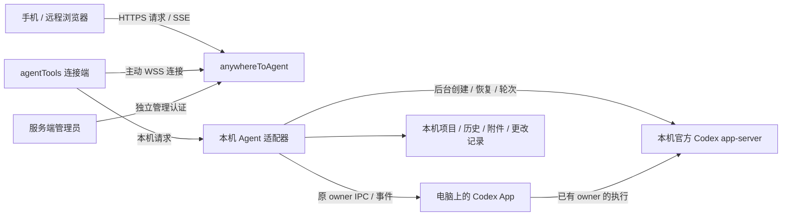

# 架构与授权边界

anywhereToAgent 是独立 Go 模块 `anywheretoagent`，提供公网中转、远程网页和服务端管理页。agentTools 内置连接端、Agent 注册表与执行适配器，目前提供 Codex 适配器。两者通过 WebSocket 协议通信，分别构建和部署；服务器不导入 agentTools 的网关、账号或本机进程代码。

## 职责

| 部件 | 负责 | 数据所在位置 |
| --- | --- | --- |
| agentTools“远程连接”页 | 选择预设/自部署服务、共享项目、连接状态、生成二维码/授权码、已授权浏览器与撤销 | 用户电脑 |
| agentTools 连接端 | 主动 WSS 连接、配对、签发和校验浏览器授权、转发到本机执行引擎 | 用户电脑 |
| 本机 Agent 适配器（当前 Codex） | 读取原生历史、新建/继续/停止任务、工具审批、文件和更改、SSE 事件 | 用户电脑 |
| Remote | 设备路由、浏览器入口、请求/响应和事件中转、设备凭证哈希、私有浏览器会话映射 | 公网服务器 |
| Remote 管理页 | 服务监听、公网地址、新设备注册设置、服务状态 | 公网服务器 |

中转只转发应用层端到端加密数据，继续保留 HTTPS/WSS。电脑与浏览器使用 AES-256-GCM 和 HKDF-SHA256；256 位配对秘密只在完整授权码/URL fragment，独立会话密钥与原始授权 token 经加密配对交付。Remote 不持有解密密钥，状态文件只存设备/浏览器授权 ID 的路由映射。

POST /api/pair 接收 {device_id,id,data}，向电脑 /_remote/pair 转交 {id,data}，验证返回 sealed 的形状和元数据后建立 HttpOnly cookie。POST /api/secure 将 {id,data} 原样流式转到电脑 /_remote/secure，外层只带公开授权 ID；方法、路径、headers、正文与原始授权 token 在密文内。响应 application/x-ndjson 由认证 head/data/end 记录组成，序号、方向、请求 ID 绑定认证附加数据；浏览器验证完整结束，不信任中转明文错误中的会话字段。会话、队列、SSE、文件预览/下载及全部附件都走同一加密入口，保留取消、撤销、背压和有界窗口；浏览器不使用明文 EventSource 或原始资源 URL。

旧明文配对和会话/文件 API 拒绝。两端须一起升级，旧浏览器需重新配对，不能降级。启动加载完整合法状态后原子删除旧原始 grant 映射，保留设备和新加密授权；读取错误仍拒绝启动。电脑持久化短期请求 ID 防重放。外层请求上限 48 MiB（加密与 Base64 开销），实际附件仍由本机限制 20 MiB。

电脑须登录 active FullCupAI 账户且余额严格大于零，GUI/无界面入口、配对、每次执行与最长 30 秒周期复验均在电脑实时向平台确认，读取错误拒绝使用。退出/切换账号断开连接；浏览器授权绑定签发账户。设备握手通过原生专用头 `X-Remote-FullCup-Token` 临时提交访问凭证，中转只向固定 `https://tobapi.fullcupai.com/api/v1/auth/me` 核实用户 ID 和资料，拒绝重定向及失效/停用账户；不保存或记录平台 token。已绑定设备不能无凭证重连或自动转给另一个账户；旧未绑定设备可以继续原有配对流程，在更新客户端首次以有效平台身份重连时绑定。

`/account` 是用户设备页，使用同一 FullCupAI 邮箱/密码及平台要求的 TOTP 登录；平台访问 token 也可作为原生交接输入，不返回浏览器。密码、平台访问及刷新 token 均不持久化；服务端只保存 FullCupAI 用户资料及 12 小时 HttpOnly、SameSite=Strict 账户会话的随机值哈希。账户登录仅授予查看、重命名、撤销该账户设备的目录权限，不签发 E2EE 密钥，不替代各电脑的浏览器配对授权。持有某个电脑配对码也不能进入该账户设备管理。

`GET /api/account` 返回当前用户与其设备；`POST /api/account/device` 以 `{id,name}` 重命名或 `{id,revoke:true}` 撤销，跨账户 ID 返回 404。管理员仍使用独立的管理凭证与认证，`/api/admin/state` 增加用户和设备所属用户 ID，`POST /api/admin/user` 的 `{id,disabled}` 可以停用或恢复中转用户。停用会原子撤销其账户会话和浏览器路由授权，并断开其在线设备；恢复后须重新登录/配对，不能复活旧会话。用户资料默认来自平台，无本地注册密码或邮箱修改接口。平台验证码挑战或第三方登录暂不代理，失败会明确提示；TOTP 使用平台真实 `totp_code` 字段。

安全边界：Remote 仍知路由标识、设备名、在线状态、时间和密文大小。网页脚本由中转提供，密钥在同来源 localStorage；端点失陷、同来源 XSS 或恶意替换脚本可窃取密钥。因此本方案防被动中转读取和状态文件泄漏，不承诺抵抗恶意网页服务器或前向保密。可信 HTTPS 来源与静态资源完整性仍为前提。

## Agent 接口与目录边界

中转的设备登记、授权、密文转发和 HTTP 隧道不依赖某个 Agent。Agent ID、会话路径、owner epoch 和能力均在端到端密文内，中转不解析、不保存，不把它们加入公开 WebSocket 注册元数据。新增适配器不要求在服务端添加执行分支。

本机 `internal/remoteclient/agent` 定义 `Descriptor`、`Config`、`Runtime` 与 `Adapter`；`engine.Registry` 按稳定 ID 选择适配器。每条连接使用一个配置中的 active Agent，当前内置 `codex`；未知或未安装的适配器启动失败，不自动回落。加密 `GET /api/agents` 返回 `{agents:[{id,name}],default_agent}`，只列出当前 active Agent。后续添加适配器时须提供客户端实现及网页的对应能力适配，单独注册名称不会产生可用执行能力。

加密请求可带 `X-Remote-Agent`；不带时兼容当前 active Agent，带其它 ID 时返回 `409`，防止旧会话操作被投递到另一种执行引擎。`X-Remote-Owner-Epoch` 是通用 owner 代际字段，Codex 保留旧 `X-Codex-Owner-Epoch` 兼容。网页所见能力仍来自真实适配器，不能仅靠 Agent 名称宣称支持队列、计划或审批。一次连接同时运行多个 Agent 不属于当前契约。

服务端目录按运行职责划分：

| 路径 | 职责 |
| --- | --- |
| `cmd/anywhereToAgent` | 进程入口、配置参数、监听与退出；兼容旧默认数据路径 |
| `internal/relay/server.go`、`http.go`、`assets.go` | 服务生命周期、来源校验、路由与嵌入网页 |
| `internal/relay/devices.go`、`connection.go`、`state.go` | 设备目录/撤销、WSS 登记与心跳、原子私有持久化 |
| `internal/relay/sessions.go`、`pairing.go`、`secure.go` | 浏览器授权映射、配对、受限密文代理 |
| `internal/relay/admin*.go` | 独立管理凭证/会话、来源校验、管理路由 |
| `internal/transport/tunnel` | 有界 HTTP 帧、共享 WebSocket peer、请求/响应及背压，不导入 Agent 执行代码 |
| `web/src/agents` | 网页 Agent 适配入口；现有 Codex 控制及展示逻辑保留其专属语义 |

名称兼容：二进制和新部署模板使用 `anywhereToAgent`，Go module 使用 `anywheretoagent`。既有 `relay-state.json` schema、`admin-token`、`codex-remote` / `__Host-codex-remote` 浏览器 cookie 以及 `codex-relay-admin` 管理 cookie 保持不变，重命名不会清除浏览器授权。通用写请求标记为 `X-Remote-Request: 1`、管理标记为 `X-Remote-Admin: 1`，同时接受原 `X-Codex-Remote` / `X-Codex-Admin`，来源校验不变。中转向旧客户端转发时仍附带旧请求标记；浏览器提供的明文 Agent、owner、游标与任意其它头全部剥离。新安装默认使用系统配置目录下 `anywhereToAgent`；原 `codex-remote` 路径已存在时继续使用原位置；显式数据目录优先，服务不会迁移、合并或删除目录。Compose 的新入口变量为 `ANYWHERE_TO_AGENT_PUBLIC_URL`，原 `CODEX_REMOTE_PUBLIC_URL` 继续作为后备值。

## 一次配对与长期授权

1. 客户端选择中转 URL，生成并持久化设备身份和设备连接凭证，主动连接服务器。服务器保存设备凭证的哈希，用于后续重连，设备 ID 只用于路由。
2. 用户在 agentTools 点击生成授权码。客户端生成一次性随机码，有效 10 分钟，并在本机生成包含完整授权信息的二维码。二维码不提交第三方生成服务。
3. 浏览器打开中转网页，扫码或输入完整 `设备 ID.授权码`。服务器将配对请求转发到对应客户端；仅知道设备 ID 不允许访问。
4. 客户端解密并消耗配对秘密，签发有效期 30 天的浏览器授权，原始 token 仅加密返回浏览器。服务器将公开授权 ID 映射到 HttpOnly 会话，不保存原始 token 或会话密钥，不把秘密放入查询参数或日志。
5. 每次会话/文件请求在密文内携带客户端授权，由电脑解密并校验有效期、账户、撤销和重放状态。服务器重启后可恢复映射，但不能绕过离线、过期或已撤销的客户端授权。
6. 客户端可列出并撤销某个浏览器。撤销后其后续请求失败，活动流也终止；如需再次连接，用户重新生成授权码并配对。

授权码单次使用，重新生成会使先前未使用的码失效。客户端明确断开连接不等于撤销所有长期浏览器授权；再次连接后，仍有效且未撤销的授权可以恢复使用。删除客户端身份或清除授权状态会使旧授权失效。不要在客户端不在线时仅由服务器批准新浏览器。

设备登记开关只控制新设备注册。关闭后，已登记客户端仍可用原凭证重连；浏览器仍需得到客户端授权。服务端管理凭证与客户端配对授权不能互换。

## 连接与任务生命周期

客户端主动连接 Remote，家庭网络和 NAT 无需开放入站端口，也无需逐用户 SSH 反向隧道。默认服务只是一个预设 URL，自部署服务使用同一协议。公网使用 HTTPS/WSS；HTTP 仅供本机回环开发。

短暂断网或中转重启会中断传输，客户端按退避策略重连；本机执行引擎保持运行。浏览器恢复后读取当前快照再接收增量，刷新页面不会重发任务。显式断开远程连接或退出 agentTools 则关闭其执行引擎和自己创建的 Codex 子进程；原 App 持有的会话和共享 app-server 中的任务继续运行。其它 Codex App 进程不由连接端管理。

事件流以本机 SSE `id` 和加密 `Last-Event-ID` 支持续接；游标、正文和恢复状态都在端点，中转不解析或保存。电脑缓存最多 64 个状态、估算 8 MiB、每项最多 4 MiB，有效 2 分钟；匹配会话/owner 时补齐显示状态变更，否则返回 reset 快照。不是逐 token 日志回放。浏览器只为事件流按 0.5–10 秒退避重连，关闭取消；认证/4xx、加密认证或完整性错误终止，归档/不可用事件终止。不自动重试任何控制或附件写入。旧网页忽略新增 id，旧电脑不发 id 时继续以快照恢复。

本机 app-server 断开后，只读 RPC 可在 10 秒内重建同模式执行连接并重试一次；共享 daemon 不降级为独立进程。连接恢复不重发消息/审批，不自动恢复轮次，旧 epoch 的控制仍拒绝。重新连接会话需由电脑确认真实 owner；中转不参与执行所有权恢复。版本/传输/IPC 支持范围只在 agentTools 本机诊断导出，不向公网暴露诊断端点。

中转在设备登记成功后每 20 秒发送 WebSocket Ping，8 秒内没有 Pong 就关闭该传输并释放设备在线占用，防止代理残留的旧连接一直拒绝同一设备重连。关闭连接不撤销设备或浏览器授权，也不终止本机任务；仍在线的连接不能被新连接顶替，重连仍校验原设备凭证与撤销状态。正常断开、管理员撤销和服务关闭都会取消并等待心跳退出。实现位于 [`connection.go`](../internal/relay/connection.go)，失联回收、正常设备保持在线及原凭证重连的回归位于 [`devices_test.go`](../internal/relay/devices_test.go)。这是标准 Ping/Pong 控制帧，不改变两端注册与业务消息协议。

执行中的补充消息默认排队；网页可编辑等待或失败项、引导当前轮次或删除。编辑使用 `PATCH /api/threads/{id}/queue/{messageID}`，保持消息 ID、顺序和原附件；不允许修改投递中或结果不确定的消息。原 App owner 使用其原生队列：本机只读初始 `queued-follow-ups` 状态，随后接收经过 owner 验证的 `thread-queued-followups-changed` v2，修改通过 `thread-follower-set-queued-follow-ups-state` v1 执行。队列不在会话快照里；读取失败不能视为空，不能覆盖 App 已有消息。原生消息通过队列项 `native: true` 标识；即使 owner 已转为后台，其文本编辑仍只传 `{text}`，执行端保留完整原始上下文、附件和提交选项。

自有后台会话使用本机持久队列，并通过同一原生队列广播及控制供 App 跟随；服务器只中转 API 和 SSE。一个会话只有实际 owner 负责投递，跟随 App 时本机 worker 不再另行发送。旧本机队列保留可见、暂停，明确恢复后按原 ID 迁移并保留 App 已有内容；不确定结果不能自动迁移或重发。后台队列正常完成后按顺序发送下一条，失败、中断或本机引擎重启后暂停。入队使用有界幂等收据，最多每会话 32 条、全局 256 条；本机队列每会话最多 16 条、全局最多 100 条。

引导绑定当前轮次和稳定消息 ID。网页调用 `POST /api/threads/{id}/queue/{messageID}/steer` 时携带点击时所见的 `expected_turn_id`；缺失、空或已过期的轮次均拒绝，不自动改向新轮次。当前 App 的开始轮次返回 `{result:{turn:{id}}}`，引导返回 `{result:{turnId}}`；连接端按真实结构确认。临时引导气泡可能早于执行确认，不能据此判断成功或自动重试。远程页面显示实际 `steeringUserMessage.input`，保留源消息的 pending/accepted 状态；不把“已接受”当作任务完成。owner 切换时重置队列版本并丢弃旧请求响应。

SSE 增量经 WebSocket 转到 Remote，再持续发送给浏览器；代理必须支持 WebSocket Upgrade 并关闭 SSE 缓冲。中转断开不能伪造成任务完成。取消请求、慢浏览器、消息尺寸和并发均需要有界处理，不能无限缓存完整输出。

2026-10-20 续传验收：本地全 Go 模块 race、网页 typecheck/资源构建和 Chromium/WebKit 全网页 226 项通过；加密传输与续传聚焦 8 项覆盖 cursor、关闭取消、503/断网重试、401 终止和密文完整性终止。使用最终资源的真实本地 Relay 与 agentTools Manager 双浏览器加密互通通过，执行引擎使用 fake。未部署公网或使用真实 App/模型、手机及 Windows/Linux 实机验收。

## 本机执行与权限

`internal/remoteclient` 位于 agentTools：连接管理、设备身份、配对和浏览器授权；其 `agent` 子包定义执行适配接口，`engine` 子包注册和选择适配器；当前 Codex 实现负责原有会话能力。模型供应商、API 接入和 Codex 数据目录都来自用户电脑的配置。需要经过 agentTools 网关时，沿用 agentTools 的 Codex 接入；Remote 不改变模型请求路径。

共享项目限定历史列表、文件搜索/引用、预览和下载。浏览器不能指定未共享目录。网页主菜单使用 Codex 的三档审批模式：请求批准（内部值 `workspace-write`）映射为 workspace-write 沙箱、`approvalPolicy: on-request` 和 `approvalsReviewer: user`；帮我批准（`auto-review`）使用同一沙箱与审批策略，并设置 `approvalsReviewer: auto_review`；完全访问（`full-access`）使用 danger-full-access 沙箱、`approvalPolicy: never` 和 reviewer user。旧 `read-only` 会话保留兼容。full-access 按本机运行用户权限执行，不能把共享文件列表误认为操作系统沙箱。

原应用会话以实际 owner 的设置为准。网页更改模型、强度、模式或权限时调用 `POST /api/threads/{id}/settings`，携当前 owner epoch，仅传用户改变的字段；等待本机原 owner 的规范快照确认后返回 `options`，详情及 SSE 的 `live.options` 同步实际设置。请求未确认时保留原设置与草稿，不伪装为保存成功。普通发送未明确选择新设置时继承原 owner，不重新应用网页默认沙箱或 reviewer。自定义沙箱、额外根目录和不能准确映射的命名 profile 保持自定义，不自动转换成只读或完全访问。组织 requirements 和原 App 的验证仍适用，原生拒绝或未确认时报告错误，不降级伪装为已启用。

执行引擎保留流式文本、可用的思考摘要、命令/工具、审批、追问及计划。 完全访问映射为原生完整沙箱权限及 `approvalPolicy: never`；其它权限保留原生按需审批。Computer Use 的应用授权独立于沙箱，不能由完全访问自动批准。网页只在工具明确提供记忆范围时显示本会话/始终允许按钮，由用户选择；客户端校验请求提供的范围后传递 `_meta.persist`。通用工具问询与 URL 授权不适用此记忆逻辑。只有完成的原生 plan item 才形成待执行计划；用户明确执行才新开执行轮次，同一计划防止重复执行。网页在计划完成后提供执行与继续修改两个入口；继续修改会打开补充意见弹窗，在同一会话以计划模式发送意见，保留普通输入框的草稿和附件。修订后的计划完成后再次等待用户选择，提交失败则保留意见供重试。命令产生的文件通过轮次前后的真实工作区快照补充更改记录，不从命令字符串猜测文件；扫描和预览仍有边界及截断提示。这些测试与详细实现随 agentTools 连接端维护，服务器不再扫描文件系统。

仅读取原生历史不等于接管执行进程；可控制状态须由本机确认实际 owner 和能力。上游不发送的增量、隐藏推理及私有功能不能由中转恢复。

## 服务端配置和持久化

`cmd/anywhereToAgent` 启动网页/中转监听及独立管理监听。`internal/relay` 维护服务端，`internal/transport/tunnel` 定义传输协议。网页资源嵌入二进制。配置只有 `public_url`、`listen_address`、`data_dir` 和 `registration_enabled`，不包含 Codex 程序、Codex home、共享根目录、SSH 或模型凭证。

私有数据目录保存 `relay-state.json` 和 `admin-token`；示例将管理员提供的配置文件也存为该目录的 `config.json`，只有显式指定 `--config` 才加载它，服务不会自动重写配置文件。`relay-state.json` 保存设备凭证哈希、浏览器授权映射、FullCupAI 用户资料、设备用户关联/别名及账户会话哈希，权限 0600；会话映射及用户资料仍须私有保护；不含平台凭证、原始授权 token 或加密密钥。原状态无需迁移文件即可载入，新增字段之后旧二进制因严格解析会拒绝读取；回滚应使用同时备份的旧状态，并知悉备份后撤销/新增的授权差异，不能静默删除新字段。`admin-token` 是独立管理凭证，也为 0600。解析失败不能当作空授权列表覆盖原状态，应报告错误并保留原文件。

管理监听默认 `127.0.0.1:9090`，服务器网页监听默认 `127.0.0.1:8080`。反向代理须保留原始 Host；写请求校验 Origin 和专用请求头。服务端管理权限仅管理中转实例，不授予任何客户端的 shell 或项目访问。

## 维护与验证

远程聊天页使用 React 19 与 Solid Glass。`web/src/remote.jsx` 启动应用；`RemoteApp.jsx` 组合 `views/Pairing.jsx`、`Workspace.jsx` 和 `Dialogs.jsx`。`controller.jsx` 保留共享控制器状态和 feature 装配；`features/` 按会话、owner、生命周期、设备、消息、事件流、队列、设置、审批、附件、建议、文件及计划拆分，`features/bindings.jsx` 管理 DOM 事件，`render.jsx` 同步提交 React 动态区域。加密 HTTP、取消与 owner 代际请求位于 `transport/api.js`，加密与续传实现位于 `transport/secure.js`；经 `RemoteSecure.fetch/events` 的 API、文件、附件和 SSE 请求都在密文内固定当前 `X-Remote-Agent`，owner 控制同时发送 `X-Remote-Owner-Epoch` 和兼容用的 `X-Codex-Owner-Epoch`。Agent descriptor 从加密 `GET /api/agents` 读取；每会话选项的 `agent` 须与当前 active Agent 一致。`agents/registry.js` 选择适配器，`agents/codex.js` 集中 Codex 的模型与 reasoning effort、权限、审批类型、来源标签、历史内容和桌面 deeplink 语义；未知 descriptor 使用不含 Codex deeplink 和权限推测的通用展示适配器。Agent 切换会取消旧请求和事件流、清除会话/owner/队列状态，并按 Agent 隔离草稿，避免相同会话 ID 被投到新执行端。Agent 执行仍由本机连接端负责，中转不解释或持有密文内的 Agent 字段。管理后台 `admin.jsx` 使用独立 React 状态与管理认证。Solid Glass 上游源码和 MIT 声明随项目保存，所有 JS/CSS 由 Vite 本地打包进 Go 资源，无 CDN、外部字体请求或额外运行服务。公共固定路径 JS/CSS 在进程内预压缩，支持 gzip、基于内容的弱 ETag 及每次使用前重验证，未变化返回 304；HTML、账户/配对 API、密文请求和会话数据仍为 `no-store`，不进入此静态缓存。深浅外观可切换，偏好仅存在本地浏览器。手机宽度（不超过 760px）或粗指针设备上的文本输入控件至少 16px，避免 iOS 聚焦自动放大；viewport 继续允许用户缩放，不设置 `maximum-scale` 或 `user-scalable=no`。移动布局与焦点回归在 Chromium/WebKit 及支持语言中验证，仍需 iPhone 实机键盘验收。

模型和思考强度共用设置卡片；模型选择仍使用原有菜单。滑块只使用当前模型返回的 `supportedReasoningEfforts`，拖动 `input` 仅预览，`change` 才沿既有 settings 路径提交一次。等待实际 owner 的规范设置确认，失败恢复已确认值并保留草稿；owner/generation 变化关闭卡片，不把旧控件的选择发送给新会话。恢复默认沿用模型或配置的真实默认档位；空或单档列表禁用滑块，不添加并不存在的 Ultra 档。

工具调用在同一已知 `turn_id` 内按连续项展示为可展开批次，消息、思考、计划及其它活动会结束当前批次。当前协议没有原生批次 ID，因此此分组只影响网页展示，不改变执行顺序或推断并行关系；缺少轮次 ID 的调用保持独立。批次保留每条调用的原有详情，流式更新保留批次及内部调用的展开状态。

输入框旁的上下文圆环使用本机返回的当前用量与窗口大小，点击查看具体 token 数；图形限制在 0–100%，文字保留真实数值。未知用量显示未知环，不显示成 0% 或保留上次进度；压缩状态独立显示，压缩后跟随新的实际用量。现有数据不包含输入/输出分类，因此详情不推测这些值，也不把当前请求用量解释为会话累计消耗。

连接诊断与日志导出由 agentTools 本机连接页提供，受本机 Host/运行令牌保护；Remote 不接收这些诊断 API，也不保存设备凭证、配对码或会话正文日志。Windows 后台启动同样由本机负责，网页不要求先使用 macOS 的可选共享启动器。

改动协议应同时更新两端的发送方/接收方、认证边界、浏览器和夹具。两端均需要本地 fake peer 的行为测试：一次性码、过期/撤销、错误设备凭证、跨来源、重连、慢流和取消。服务端执行 `make test-race`、`make vet` 和浏览器回归；客户端执行 `go test -race ./internal/remoteclient/...` 并运行对应 GUI 测试。Go 测试使用隔离配置及 HOME，不能访问用户真实凭证。

部署模板与代码检查不能替代真实公网配对验证。容器构建、系统服务启停、真实移动设备及目标服务器的检查结果需要在发布记录中分别注明。

## 后台会话执行与同步

网页新建显式发送 `POST /api/threads`、`executor: "background"`，连接端省略 executor 时也默认后台新建；本机 `createBackground` 校验共享项目及设置，通过官方 `thread/start` 创建、`thread/name/set` 持久化，并保留执行连接。它不调用桌面深链接，不发送首轮或伪造队列。已有共享 app-server 可复用，否则执行进程由本机 agentTools 持有；Remote 从不运行 Codex。

创建前重新读取本次 options 并确认 `capabilities.background_creation: true`，失败为未知；旧客户端无此能力时明确要求更新，不能回退为桌面创建。已分配 ID 后失败返回 `created_thread_id`，网页绑定已有 ID、保留草稿及附件，不自动另建或重发。创建成功先进入新会话，再异步刷新列表。

选择历史先显示只读分页详情。自动连接、手动连接及重试都要求 `live.owner.capabilities.background_connect: true`，并调用 `POST /api/threads/{id}/connect`、`executor: "background"`。本机先发现原 owner：已存在就跟随，无 owner 才 `thread/resume` 同一 ID；超时、协议错误或归属不确定时拒绝恢复。此连接不发起模型轮次，不依赖桌面当前页面。旧客户端只有 `connect: true` 时提示更新，不回退到深链接；明确的“在 Codex 中打开”链接仅用于用户主动打开应用。

详情、options 并行获取，完整模型/工具目录不阻塞历史、后台连接或已有 SSE。选择变化、归档及退出取消旧请求；迟到的详情/连接/事件不能覆盖新选择。刷新、轮询和 SSE 只读跟随，不恢复所有历史或重发消息。后台连接成功可附带已确认的 `live` 快照（与 SSE 相同的 owner、epoch、选项和队列形状），网页直接应用并恢复控制，不为解除连接提示再下载整份历史；已有更新的 SSE 状态优先。旧客户端仅返回 `connected` 时仍读取详情确认，不推测控制权限。

侧栏读取加密 sessions 响应的 sidebar_projects（id、name、root_paths）、pinned_ids 及会话行 project_id / pinned，按原生顺序显示置顶、本机项目和最近会话；空项目仍可从侧栏选择后新建，项目名称来自 App 元数据。已加载的每个会话只出现一次，搜索和项目筛选继续生效，缺少新字段的旧客户端保留路径分组。项目/置顶状态由 agentTools 只读原生 App 状态与 SQLite 目录得到，不在中转持久化，也不借网页修改官方 App 数据。

现代历史目录从当前最高版本官方 SQLite 索引读取，按 ID 定点查找，无需逐条解码全部 rollout 或逐页等待 `thread/list`。详情优先有界 rich history，成功时不同时传整份 legacy 正文；更早内容经游标分页。旧版缺少目录字段时兼容回退，读错误标记 `history_unavailable`，不视作空目录。

归档仍每次检查：列表 `archived_ids` 是明确证据；详情和控制返回 410、`archived: true`；流发 `archived` 并结束，不停止外部任务。归档元数据不可读时禁用控制，显式刷新成功后才恢复。活跃流最多每秒检查一次，空闲流约 12 秒内检查。共享根目录、Host/Origin、客户端授权与撤销继续由既有边界校验。

`live.owner` 提供 kind/state/epoch/capabilities。后台 owner 使用 kind `background`；控制携 `X-Codex-Owner-Epoch`，中转白名单透传，最终由本机检查。归属变化或操作不确定时不自动重发。连接端通过现有本机 IPC 发布自有后台 owner，桌面可按同 ID 跟随；IPC 未提供跨应用原子 claim，另一个绕过 owner 发现的独立 CLI 同时恢复同 ID 不在保证范围内。

后台使用本机 Codex 配置；已有原 owner 继续使用它的环境、工具和权限。App 注入的私有工具、开发者指令及 UI 上下文不保证在独立 app-server 中可用。普通发送继承实际会话设置，只应用明确选择的更改，不替用户降级自定义权限。只有用户明确发送才开始轮次；引导、停止、审批及队列保留轮次和 owner 约束。上下文窗口与压缩状态、真实标题通过详情和 SSE 同步，不伪造桌面状态。

macOS 可选共享启动及 `executor: "native"` 旧路径仍保留兼容，不是后台能力的前提。启动器不退出日常 App、不改包和全局配置；已有锁/socket 不自动覆盖。Windows/Linux 本机 IPC、无 GUI 连接端继续沿用现有适配，尚需实机验收；跨平台构建不能代替运行验证。

官方 [App-server](https://learn.chatgpt.com/docs/app-server) 是公开会话协议参考。本实现使用自部署 Remote 授权和中转，没有接入 OpenAI 云端远程协议；本机 follower 兼容层受 App 版本影响，不能承诺全部私有功能永久兼容。

旧深链接路径的历史验收不证明后台新路径；原记录仍保留在客户端 `output/history-auto-connect-20261018/`。本次验证应分别报告隔离本机官方 app-server 零轮创建/恢复、两端回归、真实模型轮次、移动端及公网部署；未执行项目不得写成已验证。

前端完整采用 Solid Glass 的 Message/Bubble、Composer、Panel、AskCard、Tool Steps、表单、附件、表格与空状态结构，统一 Lucide 图标；侧栏、菜单和原生 dialog 通过本地适配保持既有焦点及取消行为。页面布局遵循官方 Agent Workspace 的阅读列、侧栏与浮动检查面板结构。样式层级将旧行为尺寸置于 legacy 层，新外观及响应式布局集中于 remote-glass.css。设计对照及受限范围记录于根目录 design-qa.md。
